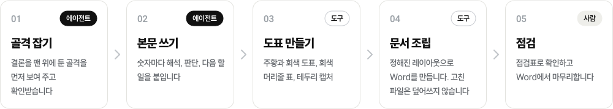
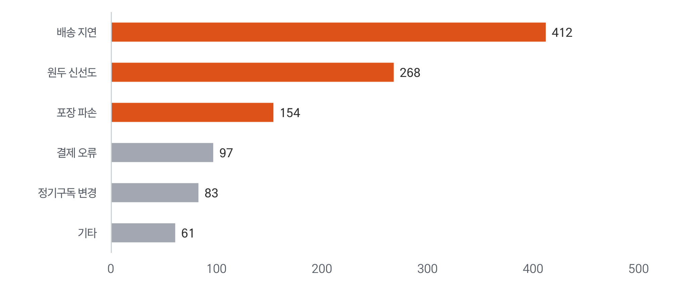
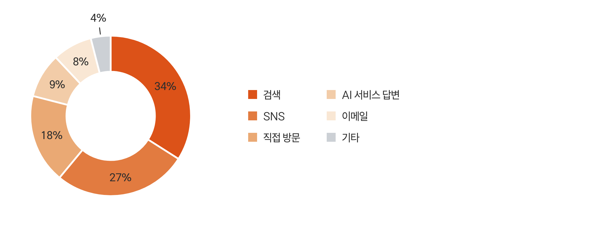

<h1 align="center">
  <picture>
    <source media="(prefers-color-scheme: dark)" srcset=".github/assets/ko/banner-dark.svg">
    
  </picture>
</h1>

<p align="center">
  <a href="LICENSE"></a>
  <a href="#빠른-시작"></a>
  <a href="#예시-보고서"></a>
  <a href="#규칙"></a>
</p>

<p align="center">
  <b>AI 에이전트가 컨설팅 보고서처럼 한국어 보고서를 쓰고, Word 문서까지 만드는 스킬입니다.</b><br>
  결론을 먼저 쓰고, 숫자마다 해석을 붙이고, 주황과 회색의 절제된 도표와 정해진 레이아웃으로 만듭니다.<br>
  폴더 하나를 스킬 폴더에 복사하고 보고서를 요청하면 됩니다.
</p>

<p align="center">
  <a href="README.md">English</a>&nbsp;&nbsp;|&nbsp;&nbsp;<b>한국어</b>
</p>

<p align="center">
  <a href="#빠른-시작"><b>빠른 시작</b></a>&nbsp;&nbsp;&nbsp;|&nbsp;&nbsp;&nbsp;
  <a href="#작업-흐름">작업 흐름</a>&nbsp;&nbsp;&nbsp;|&nbsp;&nbsp;&nbsp;
  <a href="#규칙">규칙</a>&nbsp;&nbsp;&nbsp;|&nbsp;&nbsp;&nbsp;
  <a href="#도표">도표</a>&nbsp;&nbsp;&nbsp;|&nbsp;&nbsp;&nbsp;
  <a href="#예시-보고서">예시 보고서</a>&nbsp;&nbsp;&nbsp;|&nbsp;&nbsp;&nbsp;
  <a href="#파일-지도">파일 지도</a>
</p>

## 빠른 시작

Node 18 이상과 Python 3.9 이상이 필요합니다.

| 순서 | 할 일 |
| :---: | --- |
| 1 | 스킬 폴더를 Claude Code 스킬 폴더에 복사합니다 |
| 2 | 도표와 Word 도구를 한 번 설치합니다 |
| 3 | Claude Code에서 보고서를 요청합니다(`/consulting-report`를 입력해도 됩니다) |

```bash
git clone https://github.com/chanthr/Report-Writing-Style-Consulting.git
cp -r Report-Writing-Style-Consulting/consulting-report ~/.claude/skills/

cd ~/.claude/skills/consulting-report
npm install                       # 도표를 그리는 Playwright
npx playwright install chromium   # 도표를 그릴 브라우저
pip install -r requirements.txt   # Pillow, python-docx
```

한 프로젝트에서만 쓰려면 `<프로젝트>/.claude/skills/`에 복사합니다.

다른 에이전트(Codex, Cursor, Gemini CLI)에서도 쓸 수 있습니다. 에이전트에게
[`consulting-report/SKILL.md`](consulting-report/SKILL.md)를 읽게 하면 됩니다. 규칙은 마크다운이고 도구는 일반 스크립트입니다.

## 작업 흐름

<p align="center">
  <picture>
    <source media="(prefers-color-scheme: dark)" srcset=".github/assets/ko/flow-dark.svg">
    
  </picture>
</p>

<details>
<summary>단계별 자세히</summary>

| 단계 | 하는 쪽 | 하는 일 | 규칙 문서 |
| --- | --- | --- | --- |
| 골격 잡기 | 에이전트 | 보고서가 답할 질문 하나와 그 답을 맨 위에 정하고, 골격을 글 트리로 보여 준 뒤 확인을 기다립니다 | [`1-structure.md`](consulting-report/rules/1-structure.md) |
| 본문 쓰기 | 에이전트 | 장마다 데이터, 해석, 판단, 다음 할 일로 씁니다. 문장은 건조한 비즈니스 한국어입니다 | [`2-style.md`](consulting-report/rules/2-style.md) |
| 도표 만들기 | 도구 | JSON 설정으로 도표를 그리고, 캡처를 잘라 보여 줄 자리에 주황 테두리를 얹습니다 | [`3-exhibits.md`](consulting-report/rules/3-exhibits.md) |
| 문서 조립 | 도구 | 정해진 레이아웃으로 `.docx`를 만듭니다. 사람이 고친 파일은 덮어쓰지 않습니다 | [`4-document.md`](consulting-report/rules/4-document.md) |
| 점검 | 사람 | 점검표로 확인하고 Word에서 문장을 마무리합니다 | [`5-checklist.md`](consulting-report/rules/5-checklist.md) |

</details>

스킬은 여섯 가지 원칙을 지킵니다.
1. 골격을 합의한 뒤 본문을 씁니다.
2. 숫자를 지어내지 않습니다.
3. 캡처 내용을 고치지 않습니다.
4. 사람이 고친 문서를 덮어쓰지 않습니다.
5. 도구를 복사하지 않고 가져다 씁니다.
6. 둥근 카드, 칩, 그림자, 아이콘 같은 장식을 쓰지 않습니다.

## 규칙

규칙 문서는 한국어 비즈니스 보고서를 기준으로 썼습니다. 도표, 캡처, Word 도구는 어느 언어에서나 쓸 수 있습니다.

| 문서 | 다루는 것 |
| --- | --- |
| [`1-structure.md`](consulting-report/rules/1-structure.md) | 피라미드 원칙. 결론 먼저, MECE 묶기, SCQA 도입부, 액션으로 닫는 데이터 블록, 레벨링, 얇은 부록 |
| [`2-style.md`](consulting-report/rules/2-style.md) | 비즈니스 한국어 15개 규칙. 한 문장 한 메시지, 40~50자, 능동태와 현재형, 군더더기 빼기, 욱여넣지 않기 |
| [`3-exhibits.md`](consulting-report/rules/3-exhibits.md) | 도표 문법, 도표 종류 고르기, JSON 형식, 캡처 자르기와 테두리 |
| [`4-document.md`](consulting-report/rules/4-document.md) | Word 레이아웃, 빌드 스크립트, 사람이 고친 문서에 덧붙이는 법 |
| [`5-checklist.md`](consulting-report/rules/5-checklist.md) | 보고서를 넘기기 전 점검 |

## 도표

흰 바탕에 주황과 회색을 씁니다. 막대는 각지고 막대마다 값을 적습니다. 범례는 아래에 두고, 눈금선은 꺾은선에만 둡니다.
제목과 출처는 그림 위아래에 Word 글로 써서 사람이 고칠 수 있게 합니다.

<table>
  <tr>
    <td width="50%"><br><sub>묶은 막대: <code>column</code></sub></td>
    <td width="50%"><br><sub>쌓은 막대: <code>column</code> + <code>stacked</code></sub></td>
  </tr>
  <tr>
    <td><br><sub>꺾은선: <code>line</code></sub></td>
    <td><br><sub>막대마다 색을 바꾼 가로 막대: <code>bar</code> + <code>pointColors</code></sub></td>
  </tr>
  <tr>
    <td><br><sub>도넛: <code>donut</code></sub></td>
    <td><br><sub>자르고 테두리를 얹은 캡처: <code>captures.py</code></sub></td>
  </tr>
</table>

도표 하나는 JSON 몇 줄입니다. 모든 종류의 예시는 [`examples/exhibits.json`](consulting-report/examples/exhibits.json)에 있습니다.

```json
{
  "id": "fig1-channel-orders",
  "type": "column",
  "categories": ["자사몰", "배달앱", "오픈마켓", "정기구독"],
  "series": [
    { "name": "2026년 상반기", "values": [1580, 2180, 910, 760] },
    { "name": "2025년 상반기", "values": [1240, 2310, 860, 420] }
  ]
}
```

```bash
node tools/render.mjs data.json --out 시각자료          # 도표마다 PNG 한 장, 3배 해상도
python3 tools/captures.py data.json --src 캡처원본 --out 시각자료
```

글꼴(Freesentation)은 [`consulting-report/fonts/`](consulting-report/fonts)에 들어 있어 어느 컴퓨터에서나 같은 모양으로 그려집니다.
색을 바꾸려면 JSON 맨 위에 `"colors"`를, 숫자 표기를 바꾸려면 `"locale"`을 넣습니다.

## 예시 보고서

가상의 커피 브랜드 A사 보고서입니다. [`examples/build_report.py`](consulting-report/examples/build_report.py)가 만듭니다.
회사와 숫자는 모두 가상입니다. 스크립트는 본문 숫자를 도표 데이터에서 다시 계산하고, 하나라도 다르면 멈춥니다.

<p align="center">
  
</p>

전체는 [`sample-report.pdf`](consulting-report/examples/out/sample-report.pdf)나 [`sample-report.docx`](consulting-report/examples/out/sample-report.docx)로 볼 수 있습니다.

```bash
cd consulting-report
npm run example                                                   # 도표
python3 tools/captures.py examples/exhibits.json --src examples --out examples/out
python3 examples/build_report.py --overwrite                      # .docx
```

Word 레이아웃은 아래와 같습니다.

| 항목 | 값 |
| --- | --- |
| 용지 | A4, 좌우 여백 20mm |
| 표지 | 띠 없이 제목 한 줄 |
| 본문 | 12pt, 양쪽 정렬 |
| 대제목 | 14pt 남색, 아래 실선 |
| 표 | 회색 머리줄 띠, 가로 실선만 |
| 출처 줄 | 10pt 회색 |

다른 글꼴을 쓰려면 `REPORT_FONT`를 줍니다. docx는 글꼴을 담지 않으므로 PDF로 보내거나 받는 사람에게 글꼴을 설치하게 합니다.

## 파일 지도

| 구분 | 파일 | 내용 |
| --- | --- | --- |
| 스킬 | [`consulting-report/SKILL.md`](consulting-report/SKILL.md) | 입구. 쓰는 때, 원칙, 흐름 |
| 규칙 | [`consulting-report/rules/`](consulting-report/rules) | 구조, 문체, 도표, 문서, 점검 |
| 도구 | [`tools/render.mjs`](consulting-report/tools/render.mjs), [`tools/chart.html`](consulting-report/tools/chart.html) | JSON으로 도표 PNG 만들기 |
| | [`tools/captures.py`](consulting-report/tools/captures.py) | 캡처 자르기와 주황 테두리 |
| | [`tools/report_docx.py`](consulting-report/tools/report_docx.py) | Word 레이아웃과 조립 함수, 사람이 고친 문서에 덧붙이는 함수 |
| 예시 | [`consulting-report/examples/`](consulting-report/examples) | 도표 데이터, 가상 화면, 빌드 스크립트와 결과 |
| 글꼴 | [`consulting-report/fonts/`](consulting-report/fonts) | Freesentation Regular, Medium, Bold (SIL OFL 1.1) |
| README 그림 | [`.github/assets/`](.github/assets) | 배너, 흐름도, 배지. `readme-art.json`으로 `make.py`가 만듭니다 |

## 함께 고치기

| 하려는 일 | 양식 |
| --- | --- |
| 도구가 이상하게 동작할 때 | [문제 제보](../../issues/new?template=01-bug.yml) |
| 규칙이나 도구를 바꾸자고 할 때 | [개선 제안](../../issues/new?template=02-improvement.yml) |

공개 저장소입니다. 고객사 이름, 실제 보고서 숫자, 비공개 화면 캡처, 비밀 값을 올리지 않습니다.

## 라이선스

코드와 문서는 [MIT](LICENSE)입니다. `consulting-report/fonts/`와 `.github/assets/fonts/`의 글꼴은 PT&의 Freesentation이며
[SIL 오픈 폰트 라이선스 1.1](consulting-report/fonts/OFL.txt)을 따릅니다.
