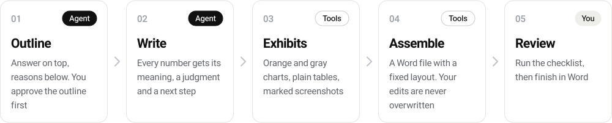
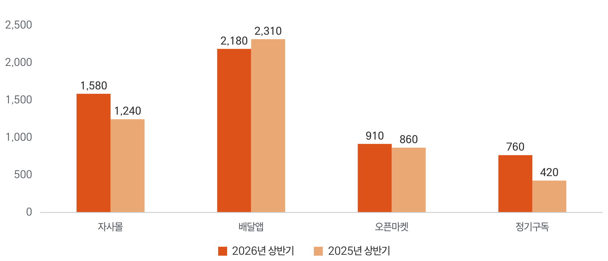
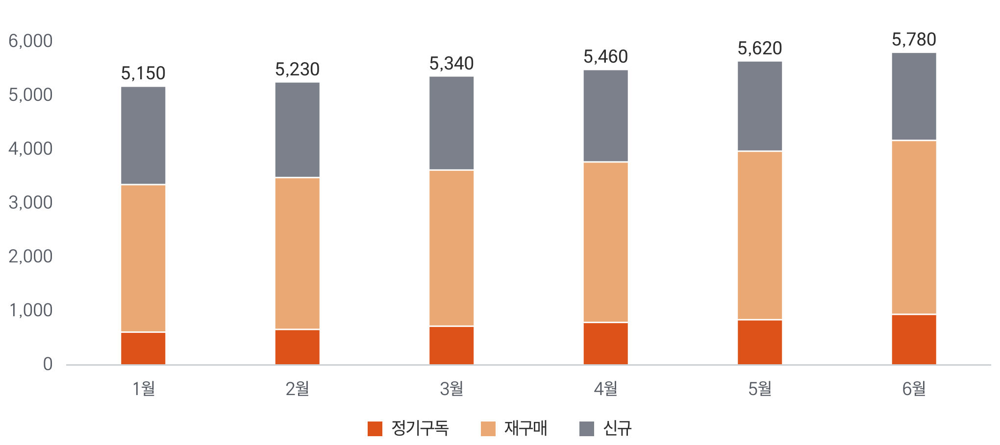
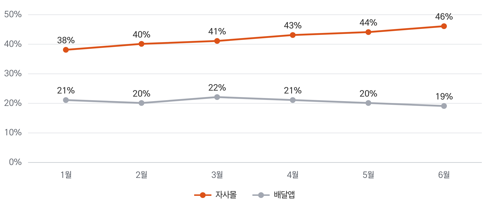
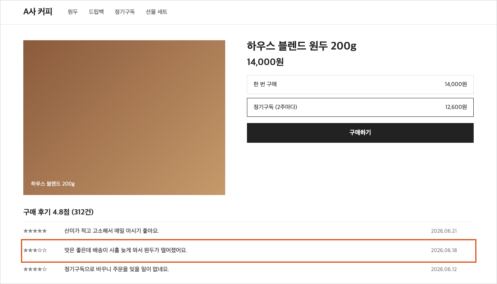
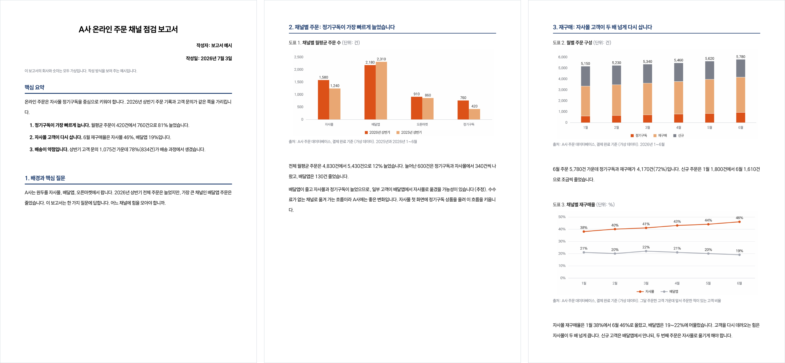

<h1 align="center">
  <picture>
    <source media="(prefers-color-scheme: dark)" srcset=".github/assets/banner-dark.svg">
    
  </picture>
</h1>

<p align="center">
  <a href="LICENSE"></a>
  <a href="#quick-start"></a>
  <a href="#sample-report"></a>
  <a href="#the-rules"></a>
</p>

<p align="center">
  <b>An agent skill that writes Korean business reports the way consultants do, and builds the Word file.</b><br>
  Answer first, every number explained, restrained orange and gray exhibits, a fixed layout.<br>
  Install it with one <code>npx</code> command and ask for a report.
</p>

<p align="center">
  <b>English</b>&nbsp;&nbsp;|&nbsp;&nbsp;<a href="README.ko.md">한국어</a>
</p>

<p align="center">
  <a href="#quick-start"><b>Quick start</b></a>&nbsp;&nbsp;&nbsp;|&nbsp;&nbsp;&nbsp;
  <a href="#how-it-works">How it works</a>&nbsp;&nbsp;&nbsp;|&nbsp;&nbsp;&nbsp;
  <a href="#the-rules">The rules</a>&nbsp;&nbsp;&nbsp;|&nbsp;&nbsp;&nbsp;
  <a href="#exhibits">Exhibits</a>&nbsp;&nbsp;&nbsp;|&nbsp;&nbsp;&nbsp;
  <a href="#sample-report">Sample report</a>&nbsp;&nbsp;&nbsp;|&nbsp;&nbsp;&nbsp;
  <a href="#files">Files</a>
</p>

## Quick start

| Step | Do this |
| :---: | --- |
| 1 | Install the skill with one command |
| 2 | Install the chart and Word tools once |
| 3 | Ask your agent for a report, or type `/consulting-report` in Claude Code |

**1. Install the skill.** The open [`skills`](https://github.com/vercel-labs/skills) installer puts it into Claude Code, Codex, Cursor and 70 more agents.

```bash
npx skills add chanthr/Report-Writing-Style-Consulting
```

It asks which agents to install for, and whether to install for this project or for your user.
To skip the questions and install for Claude Code in every project:

```bash
npx skills add chanthr/Report-Writing-Style-Consulting -g -a claude-code -y
```

**2. Install the tools once.** Charts need Node 18 or later, the Word file needs Python 3.9 or later.
If you skip this, the agent offers to run it the first time it needs the tools.

```bash
cd ~/.claude/skills/consulting-report   # in a project: .claude/skills/consulting-report
npm install                             # Playwright, used to draw charts
npx playwright install chromium         # the browser that draws them
pip install -r requirements.txt         # Pillow and python-docx
```

<details>
<summary>Install without npx</summary>

```bash
git clone https://github.com/chanthr/Report-Writing-Style-Consulting.git
cp -r Report-Writing-Style-Consulting/skills/consulting-report ~/.claude/skills/
```

For other agents, copy the folder into that agent's skills directory, or point the agent at
[`skills/consulting-report/SKILL.md`](skills/consulting-report/SKILL.md). The rules are plain Markdown and the tools are plain scripts.

</details>

## How it works

<p align="center">
  <picture>
    <source media="(prefers-color-scheme: dark)" srcset=".github/assets/flow-dark.svg">
    
  </picture>
</p>

<details>
<summary>What each step does</summary>

| Step | Who | What happens | Rule file |
| --- | --- | --- | --- |
| Outline | Agent | Sets the one question the report answers and the answer on top, then shows the outline as a tree and waits for your OK | [`1-structure.md`](skills/consulting-report/rules/1-structure.md) |
| Write | Agent | Writes each chapter as data, meaning, judgment and next step, in plain business Korean | [`2-style.md`](skills/consulting-report/rules/2-style.md) |
| Exhibits | Tools | Draws charts from a JSON file, crops screenshots and draws an orange box where it matters | [`3-exhibits.md`](skills/consulting-report/rules/3-exhibits.md) |
| Assemble | Tools | Builds the `.docx` with a fixed layout. Refuses to overwrite a file someone already edited | [`4-document.md`](skills/consulting-report/rules/4-document.md) |
| Review | You | Goes through the checklist, then finishes the wording in Word | [`5-checklist.md`](skills/consulting-report/rules/5-checklist.md) |

</details>

The skill holds six hard rules: agree on the outline before writing, never invent a number, never alter a screenshot,
never overwrite a document a person edited, reuse the tools instead of copying them, and no decoration
(rounded cards, chips, shadows, icons).

## The rules

The rules are written in Korean, for Korean business reports. The chart, screenshot and Word tools work in any language.

| File | Covers |
| --- | --- |
| [`1-structure.md`](skills/consulting-report/rules/1-structure.md) | The pyramid principle: answer on top, MECE groups, SCQA introductions, data blocks that end in an action, one level per list, a lean appendix |
| [`2-style.md`](skills/consulting-report/rules/2-style.md) | 15 rules for plain business Korean: one message per sentence, 40 to 50 characters, active and present tense, no filler, no crammed lines |
| [`3-exhibits.md`](skills/consulting-report/rules/3-exhibits.md) | The exhibit grammar, which chart to pick, the JSON format, screenshot crops and marks |
| [`4-document.md`](skills/consulting-report/rules/4-document.md) | The Word layout, the build script, and how to add to a document a person already edited |
| [`5-checklist.md`](skills/consulting-report/rules/5-checklist.md) | What to check before the report leaves your hands |

## Exhibits

White background, orange and gray, square bars with a value on each, legend at the bottom, no gridlines except on line charts.
Titles and sources are written as Word text above and below each picture, so they stay editable.

<table>
  <tr>
    <td width="50%"><br><sub>Grouped columns: <code>column</code></sub></td>
    <td width="50%"><br><sub>Stacked columns: <code>column</code> + <code>stacked</code></sub></td>
  </tr>
  <tr>
    <td><br><sub>Lines: <code>line</code></sub></td>
    <td><br><sub>Horizontal bars with per-bar colors: <code>bar</code> + <code>pointColors</code></sub></td>
  </tr>
  <tr>
    <td><br><sub>Donut: <code>donut</code></sub></td>
    <td><br><sub>Screenshot, cropped and marked: <code>captures.py</code></sub></td>
  </tr>
</table>

Each chart is a few lines of JSON. Every chart type is in [`examples/exhibits.json`](skills/consulting-report/examples/exhibits.json).

```json
{
  "id": "fig1-channel-orders",
  "type": "column",
  "categories": ["Online store", "Delivery app", "Marketplace", "Subscription"],
  "series": [
    { "name": "H1 2026", "values": [1580, 2180, 910, 760] },
    { "name": "H1 2025", "values": [1240, 2310, 860, 420] }
  ]
}
```

```bash
node tools/render.mjs data.json --out exhibits          # one PNG per chart, 3x resolution
python3 tools/captures.py data.json --src raw --out exhibits
```

The font (Freesentation) ships in [`skills/consulting-report/fonts/`](skills/consulting-report/fonts), so charts look the same on any machine.
To change colors, add `"colors"` at the top of the JSON. For another number format, set `"locale"`.

## Sample report

A short report for a made-up coffee brand, built by [`examples/build_report.py`](skills/consulting-report/examples/build_report.py).
The company and every number in it are fictional. The script recomputes each number in the text from the chart data and stops if one disagrees.

<p align="center">
  
</p>

Open the whole thing: [`sample-report.pdf`](skills/consulting-report/examples/out/sample-report.pdf) or [`sample-report.docx`](skills/consulting-report/examples/out/sample-report.docx).

```bash
cd skills/consulting-report
npm run example                                                   # charts
python3 tools/captures.py examples/exhibits.json --src examples --out examples/out
python3 examples/build_report.py --overwrite                      # the .docx
```

The Word layout: A4, 20 mm side margins, a plain title page, 12 pt justified body, 14 pt navy headings with a rule,
tables with a gray header band and horizontal lines only, 10 pt gray source lines.
To use another font, set `REPORT_FONT`. A `.docx` does not carry its fonts, so send a PDF or ask readers to install the font.

## Files

| Part | File | What it is |
| --- | --- | --- |
| Skill | [`skills/consulting-report/SKILL.md`](skills/consulting-report/SKILL.md) | Entry point: when to use it, the hard rules, the steps |
| Rules | [`skills/consulting-report/rules/`](skills/consulting-report/rules) | Structure, style, exhibits, document, checklist |
| Tools | [`tools/render.mjs`](skills/consulting-report/tools/render.mjs), [`tools/chart.html`](skills/consulting-report/tools/chart.html) | JSON to chart PNG |
| | [`tools/captures.py`](skills/consulting-report/tools/captures.py) | Screenshot crop and orange marks |
| | [`tools/report_docx.py`](skills/consulting-report/tools/report_docx.py) | Word layout and building blocks, plus helpers to add to an edited document |
| Examples | [`skills/consulting-report/examples/`](skills/consulting-report/examples) | Chart data, a mock screenshot, the build script and its output |
| Fonts | [`skills/consulting-report/fonts/`](skills/consulting-report/fonts) | Freesentation Regular, Medium, Bold (SIL OFL 1.1) |
| README art | [`.github/assets/`](.github/assets) | Banner, flow and badges, built by `make.py` from `readme-art.json` |

## Contributing

| You want to | Open |
| --- | --- |
| Report a tool that misbehaves | [Bug report](../../issues/new?template=01-bug.yml) |
| Suggest a rule or a tool change | [Improvement](../../issues/new?template=02-improvement.yml) |

This repository is public. Leave out client names, real report numbers, screenshots of private pages and secrets.

## License

Code and documents: [MIT](LICENSE). Fonts in `skills/consulting-report/fonts/` and `.github/assets/fonts/`: Freesentation by PT&,
[SIL Open Font License 1.1](skills/consulting-report/fonts/OFL.txt).
